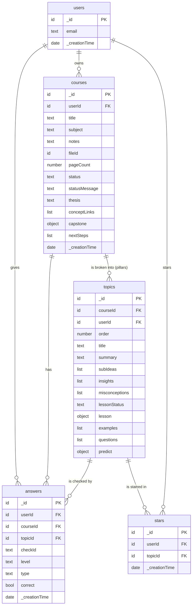

# schema.md — Ingrain database

Ingrain uses **Convex**. Each table holds documents; every row automatically gets `_id` (primary key) and `_creationTime` (date). A column typed `→ table` stores that table's `_id`: it's the foreign key. The source of truth is [`convex/schema.ts`](convex/schema.ts) (lesson shapes in [`convex/lessonTypes.ts`](convex/lessonTypes.ts)).

## Diagram

## Tables

### users
Created by Convex Auth when someone signs up. Columns: `_id`, `email` (text), `_creationTime` (date). Convex Auth also adds internal tables (`authAccounts`, `authSessions`, …) that store password hashes and sessions; the app never reads them directly.

### courses — one uploaded PDF
| Column | Type | Notes |
|---|---|---|
| `userId` | → users | owner |
| `title` | text | required, ≤ 120 chars |
| `subject` | text | optional (empty string = none), ≤ 60 chars |
| `notes` | text (optional) | ≤ 1,000 chars |
| `fileId` | → file storage | the PDF |
| `pageCount` | number (optional) | set after processing |
| `status` | text | `processing` / `ready` / `failed` |
| `statusMessage` | text (optional) | progress or error shown to the user |
| `thesis` | text (optional) | the one big idea from the concept model |
| `conceptLinks` | list of {from, to, relation} (optional) | how pillars connect, e.g. "feeds into" |
| `capstone` | {status, error?, checks[]} (optional) | end-of-course "connect" questions, built on demand |
| `nextSteps` | list of {concept, why, resourceTitle, resourceUrl} (optional) | AI suggestions + real links |
| `mindMap` | text (optional) | legacy; the concept map is now drawn from `topics` |

### topics — one pillar (core idea) of a course
| Column | Type | Notes |
|---|---|---|
| `courseId` | → courses | parent course |
| `userId` | → users | copied from the course so every query can filter by owner |
| `order` | number | learning order (prerequisites first) |
| `title`, `summary` | text | |
| `subIdeas` | list of {title, detail, children[]} | the levels of the concept map |
| `insights` | list of {text, quote} | what the lesson must teach, with a supporting phrase |
| `misconceptions` | list of text | become the "common trap" and the wrong answer options |
| `searchQuery` | text | for finding real-world examples |
| `lessonStatus` | text | `pending` / `generating` / `ready` / `failed`: lessons are built on demand |
| `lesson` | {hook, why?, visual, takeaways[], trap?} (optional) | `why` = {problem, idea}: the problem the idea solves, shown first. `visual` is one of 5 templates: flow, cycle, compare, matrix, hierarchy |
| `examples` | list of {title, description, sourceUrl} | real cases from web search |
| `questions` | list of typed questions (optional) | the practice bank, 4–8 per pillar. Types: `choice` (style apply / spot / why / core), `order`, `match`, `gap`. Levels `easier` / `apply` / `stretch`. Answer keys and explanations are never sent to the browser before answering |
| `predict` | one `choice` question (optional) | asked before the lesson on a first visit. Graded so the answer can be shown, but never saved to `answers` |
| `checks` | list of {id, level, question, options[4], answerIndex, explanation} | legacy V1 pool of 3 questions; served as `choice` questions when a pillar has no `questions` |

### answers — every check question answered
`userId` → users, `courseId` → courses, `topicId` → topics (empty for end-of-course questions), `checkId`, `level` (`apply` / `easier` / `stretch` / `connect`), `type` (`choice` / `order` / `match` / `gap`, optional), `correct` (true/false), `_creationTime` (when). A pillar is **mastered** once an `apply` or `stretch` answer is correct.

### stars — junction table
`userId` → users, `topicId` → topics. One row = "this user starred this pillar". One table for everyone; at most one row per (user, topic), enforced by the `by_user_topic` index check in `stars.toggle`.

## Relationships in plain English
- A **user** has many **courses** (one-to-many).
- A **course** has many **topics** (pillars) (one-to-many).
- A **topic** has many **answers** (one-to-many); each answer also belongs to one user and one course.
- **Users ↔ topics** is many-to-many through **stars**.

## Plan vs. built (compared with PLAN.md section 3)
- ✅ The planned tables were built: users, courses, topics, stars (junction).
- 🔁 **`quizAttempts` was replaced by `answers`** when the 5-question quizzes became adaptive checks: we now store each answer, not one score per quiz, because mastery depends on *which* question was answered right.
- 🔁 **`topics` became pillars of a concept model**: `keyPoints` and `quiz` were replaced by sub-ideas, insights, misconceptions, an on-demand `lesson`, and a 3-question `checks` pool.
- ➕ Added `courses.statusMessage` so failures are visible instead of a stuck spinner; `thesis`, `conceptLinks`, and `capstone` support the concept model.
- ➖ Removed a full-text search index on `topics.title`; search filters the user's own topics instead (see `prompts/search.md`).
- ↔ `nextSteps` lives as a list on `courses` (as planned): it's always replaced as a whole and never queried on its own.
