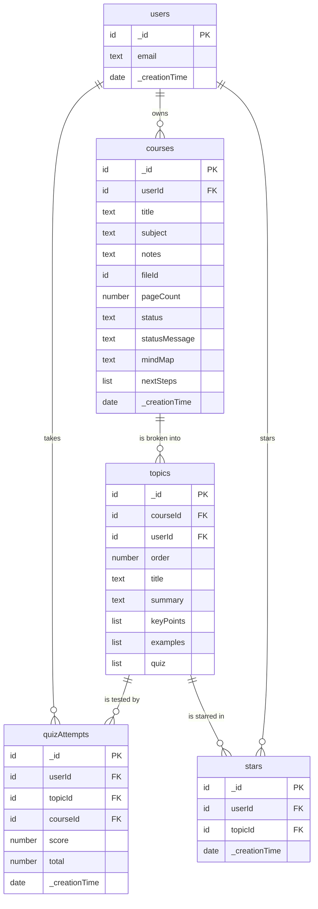

# schema.md — Recall database

Recall uses **Convex**. Each table holds documents; every row automatically gets `_id` (primary key) and `_creationTime` (date). A column typed `→ table` stores that table's `_id`: it's the foreign key. The source of truth is [`convex/schema.ts`](convex/schema.ts).

## Diagram

## Tables

### users
Created by Convex Auth when someone signs up. Columns: `_id`, `email` (text), `_creationTime` (date). Convex Auth also adds internal tables (`authAccounts`, `authSessions`, …) that store password hashes and sessions; the app never reads them directly.

### courses — one uploaded PDF
| Column | Type | Notes |
|---|---|---|
| `userId` | → users | owner |
| `title` | text | required, ≤ 120 chars |
| `subject` | text | required, ≤ 60 chars |
| `notes` | text (optional) | ≤ 1,000 chars |
| `fileId` | → file storage | the PDF |
| `pageCount` | number (optional) | set after processing |
| `status` | text | `processing` / `ready` / `failed` |
| `statusMessage` | text (optional) | progress or error shown to the user |
| `mindMap` | text (optional) | markdown outline for the mind map |
| `nextSteps` | list of {concept, why, resourceTitle, resourceUrl} (optional) | AI suggestions + real links |

### topics — key topics extracted from a course
| Column | Type | Notes |
|---|---|---|
| `courseId` | → courses | parent course |
| `userId` | → users | copied from the course so every query can filter by owner |
| `order` | number | position in the course |
| `title`, `summary` | text | |
| `keyPoints` | list of text | 3–5 points |
| `examples` | list of {title, description, sourceUrl} | real cases from web search |
| `quiz` | list of {question, options[4], answerIndex, explanation} | answers never sent to the browser before submit |

### quizAttempts — every quiz taken
`userId` → users, `topicId` → topics, `courseId` → courses, `score` (number correct), `total` (number of questions), `_creationTime` (when).

### stars — junction table
`userId` → users, `topicId` → topics. One row = "this user starred this topic". One table for everyone; at most one row per (user, topic), enforced by the `by_user_topic` index check in `stars.toggle`.

## Relationships in plain English
- A **user** has many **courses** (one-to-many).
- A **course** has many **topics** (one-to-many).
- A **topic** has many **quiz attempts** (one-to-many); each attempt also belongs to one user.
- **Users ↔ topics** is many-to-many through **stars**.

## Plan vs. built (compared with PLAN.md section 3)
- ✅ All 4 planned app tables were built with the planned columns.
- ➕ Added `courses.statusMessage` so failures (e.g. "Insufficient Balance", "scanned PDF") are visible instead of a stuck spinner.
- ➖ Removed a full-text search index on `topics.title` that the agent first added; search filters the user's own topics instead (see `prompts/search.md`).
- ↔ `nextSteps` lives as a list on `courses` (as planned), not in its own table: it's always replaced as a whole and never queried on its own.
